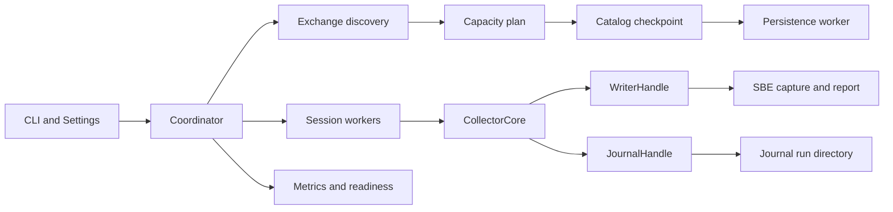
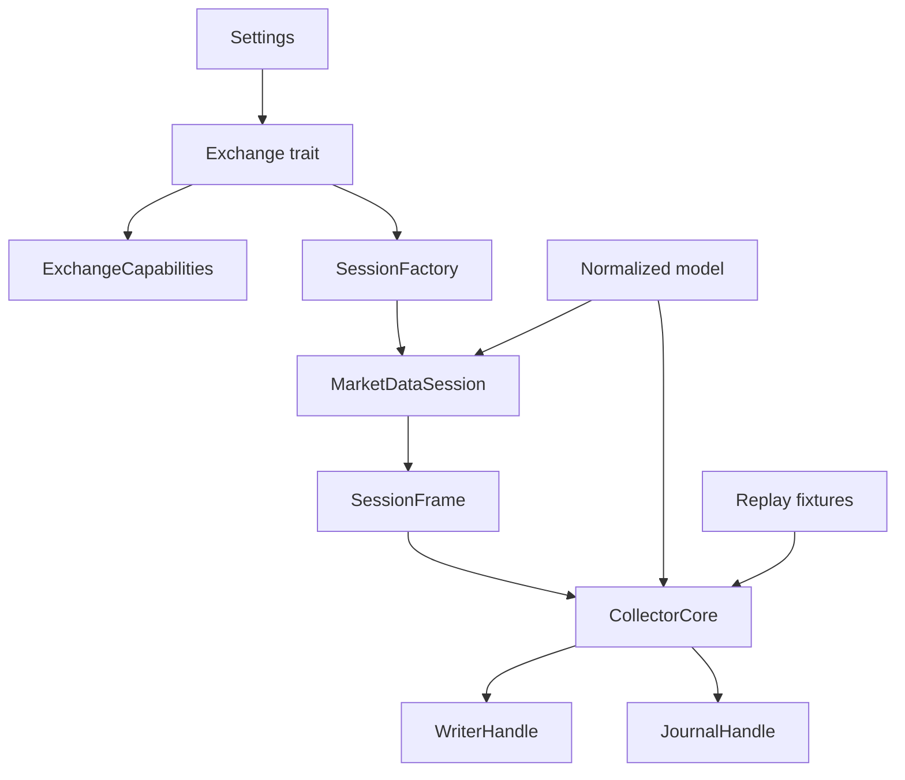
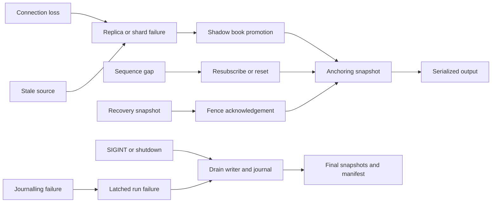

# Architecture

This document describes the implementation in `src/`, not the historical
archive audit or a target platform. Gate results are in
[`verification.md`](verification.md); requirement evidence is in
[`docs/requirement-test-matrix.md`](requirement-test-matrix.md).

## Scope

The system is a read-only prediction-market data collector. It discovers
markets, maintains one normalized order book per outcome symbol, writes the
supplied SBE schema, and optionally records exact public websocket frames. It
does not submit orders, hold positions, or run strategy or pre-trade risk.

## Runtime composition

`src/main.rs` parses the CLI and dispatches `collect`, `discover`, `replay`,
`inspect`, `verify`, `latency`, and `journal` subcommands. Live collection
enters `src/coordinator.rs`, which constructs the exchange adapter, performs
discovery, plans capacity, loads a catalog, starts session workers, the writer,
the journal, and the metrics endpoint, and then runs one serialized event loop.

Discovery is venue-specific behind `Exchange`. `src/capacity.rs` converts the
discovered records and outcome symbols into shard, connection, subscription,
memory, and snapshot-rate estimates before any worker starts. `src/catalog.rs`
persists the last complete discovery round with a schema version, counts, and a
SHA-256 envelope; `src/persistence.rs` writes metadata and catalog checkpoints
on a dedicated latest-wins thread.

Each session worker owns one websocket. It decodes frames, captures the receive
timestamp and optional raw payload, and emits normalized events. The
synchronous `CollectorCore` in `src/collector/state.rs` applies discovery,
snapshots, level changes, lifecycle events, stream resets, status, and ticks. It
chooses the active source per symbol and produces ordered output messages.
`src/writer.rs` is the only SBE writer: one bounded queue and one thread
preserve total write order. `src/journal.rs` is a separate append-only path, so
the SBE schema is unchanged. `src/metrics.rs` serves counters, health, and
readiness without putting network work on the data path.

## Abstraction boundaries

`Exchange` reports venue capabilities and creates discovery and session
objects. `ExchangeCapabilities` currently carries `has_sequence_clock`; the core
consumes that value instead of identifying a venue by name. `SessionFactory`
creates a `MarketDataSession` for one source, and `src/session.rs` supervises
reconnects, heartbeats, status, and control handling around it. Kalshi and
Polymarket implement these boundaries in `src/exchange/{kalshi,polymarket}/`.

Ownership and dependency direction are deliberate:

- adapters depend on the normalized model, not on the collector state machine;
- `CollectorCore` depends on adapter capabilities and normalized events, not on
  a websocket library;
- the coordinator owns composition and lifecycle;
- the writer owns the output file and the journal owns the journal directory;
- `replay` drives the same `CollectorCore` with fixture timestamps, so the
  deterministic path does not depend on the live coordinator.

## Failure model

A lost or failed source does not silently change history. For a sequenced
venue, a gap triggers a reset or resubscribe. For a clockless venue, failover
requires an acknowledged fence and a fresh snapshot; a recovery snapshot that
arrives before the acknowledgement is rejected without mutating the active
book. Shadow replicas are promoted only when their book is usable, and the
promotion is followed by an anchoring full snapshot. The same anchoring rule
applies to a stale source probe and to a sequence reset. Empty snapshots mark
retirement boundaries. `apply_discovery` adds and removes symbols without
mixing their histories.

Journal failures are terminal for the run: the failure latches across
producers, the writer, and finalization. Shutdown closes admission, drains
accepted writer and journal work, writes final snapshots, flushes and syncs
when configured, finalizes segments, writes the manifest, and then reports. A
bounded deadline prevents a blocked writer or journal thread from hanging
shutdown indefinitely; the run is reported as failed or incomplete instead of
being called complete.

## Module responsibilities

| Area | Files | Responsibility |
|---|---|---|
| Composition | `main.rs`, `coordinator.rs`, `cli.rs`, `config.rs` | CLI, settings precedence, adapter construction, lifecycle |
| Discovery | `exchange/*/discovery.rs`, `capacity.rs`, `catalog.rs` | Venue discovery, eligibility, capacity admission, checkpoint |
| State | `collector/state.rs`, `orderbook.rs`, `model.rs`, `fixed.rs` | Serialized books, failover, fixed-point values, output model |
| Transport | `exchange/*/session.rs`, `session.rs`, `ws.rs` | Protocol handling, supervised workers, connection options |
| Output | `writer.rs`, `util/aligned_sbe_*.rs`, `util/dtos.rs` | Ordered SBE writes, chunk framing, supplied-schema DTOs |
| Durability | `journal.rs`, `persistence.rs`, `report.rs` | Raw-frame journal, checkpoints, run sidecars |
| Offline tools | `replay.rs`, `inspect.rs`, `verify.rs`, `latency.rs` | Deterministic replay, decode, consistency, latency |
| Operations | `metrics.rs`, `time.rs` | Counters, health/readiness, receive-time helpers |

## Current operational caveat

Readiness is a local admission signal, not a venue certification. `/readyz`
reflects discovery, catalog, persistence, writer, and journal state; it cannot
prove that a live venue delivered every update. The collector is a market-data
component and is **not a production certification** for order entry, execution,
or trading. See [`operating-envelope.md`](operating-envelope.md) for measured
limits and [`design-decisions.md`](design-decisions.md) for the rationale.
Implementation contracts are in [`replay-format.md`](replay-format.md),
[`raw-frame-journal.md`](raw-frame-journal.md), and [`latency.md`](latency.md).
