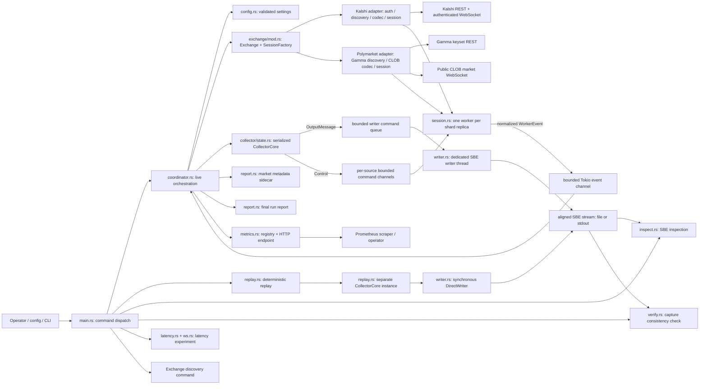
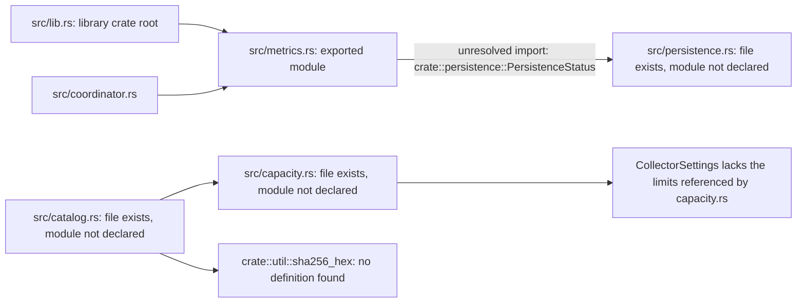
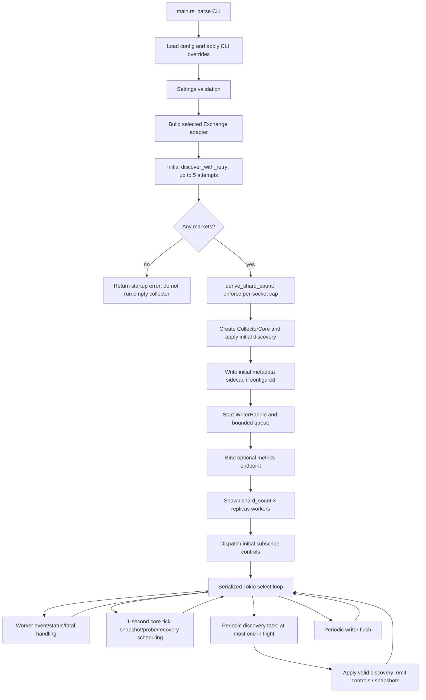
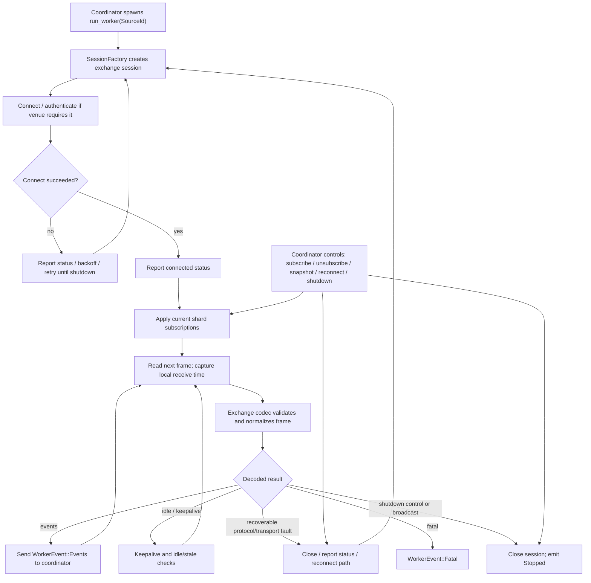
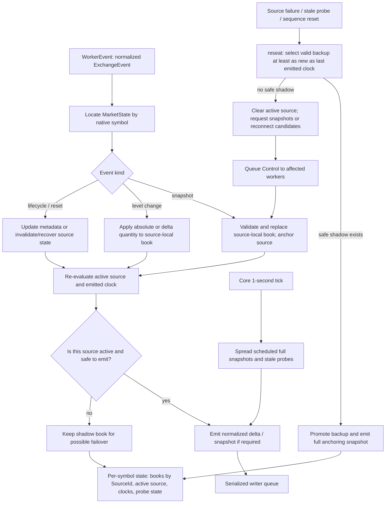
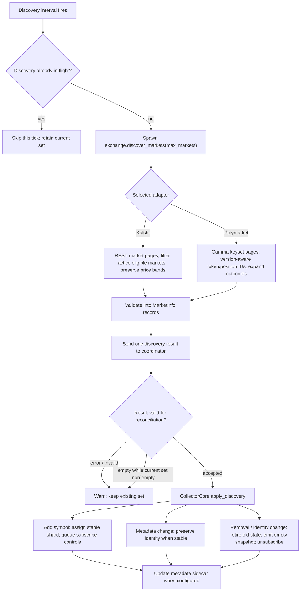
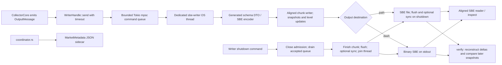
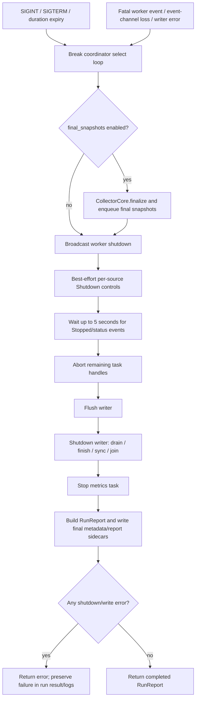

# Historical architecture audit and traceability

**Scope:** This document preserves the audit of the uploaded source archive `engineering-challenge-2026-10-26.zip`, SHA-256 `1a8d6e3d7ba53e3369d3cbac854405d96451dfd4a00a1b274e39b9c17c51188d`. The archive had no `.git` directory; its findings apply to that historical snapshot, not to the current `main` branch.

**Historical disposition:** The archived snapshot had module/API integration blockers. The audit's 2026-10-27 note records that `capacity`, `catalog`, and `persistence` were later integrated. The current `main` at `9ab6cd5a584fea58c0086efa50d55c796e9aac4` has passing [Rust CI](https://github.com/kj111422/engineering-challenge-template/actions/runs/40403111336) and [architecture CI](https://github.com/kj111422/engineering-challenge-template/actions/runs/40403111133). The diagrams below describe the earlier ZIP snapshot and must not be used as the current runtime topology. See [`docs/production-roadmap-polymarket.md`](production-roadmap-polymarket.md) for the active production target and staged gates.

This is a set of linked views rather than one unreadable mega-graph. Arrows describe control or data flow; node labels name the implementation boundary. Source paths, test symbols, crate-root reachability, and known integration blockers make each material claim auditable. “Present in source” does not mean “compiled”, “called at runtime”, or “tested”.

## 1. System topology — runtime components and boundaries



**Ownership rule.** `coordinator.rs` owns the serialized `CollectorCore` and makes the decisions that mutate books and produce outputs. Source workers own their websocket session and exchange-specific protocol state. The writer thread is the only live-collection owner of the SBE sink. Worker tasks do not write SBE directly. This prevents concurrent writes from reordering records outside the coordinator's processing order.

**Data contracts.** Exchange-specific codecs map venue frames to normalized types in `model.rs`: `MarketInfo`, `ExchangeEvent`, `EventMeta`, `SourceId`, `Control`, and `OutputMessage`. `fixed.rs` and `side.rs` supply normalized price/side semantics; `orderbook.rs` implements the normalized book; generated SBE DTOs and the aligned reader/writer adapt the supplied schema.

## 1.1. Source-root reachability — active versus unintegrated files



The active source graph is not internally consistent in this archive. `src/lib.rs` exports neither `capacity`, `catalog`, nor `persistence`. The metrics module has already been changed to depend on `PersistenceStatus`, while the coordinator still uses the old `MetricsRegistry::new(exchange)` and `registry.update(core, writer, sources)` call shapes; the definitions in `metrics.rs` require a readiness policy and a fourth `RuntimeStatus` argument. If the dormant files were simply added to `lib.rs`, further compile errors would remain: `capacity.rs` reads collector limits absent from `config.rs`, and `catalog.rs` references `util::sha256_hex`, for which no definition exists in the supplied `src/` tree. This is an integration gap, not a diagramming choice.

## 2. Startup and steady-state orchestration



Startup ordering is material: **initial discovery finishes before workers start**. Failures are retried with exponential waits by `discover_with_retry`; an empty initial result is rejected. When automatic sharding (`shards = 0`) is configured, the number of shards is derived from the discovered symbol count, bounded by `max_shards`, and checked against `max_symbols_per_socket`. Explicit shard counts are checked against the same per-socket limit.

During steady state the main loop serializes every `CollectorCore` mutation. Discovery pagination runs in a spawned task so it does not itself hold the event loop while making REST calls. The `discovery_in_flight` flag and one-slot result channel prevent overlapping discovery tasks. A failed, invalid, or empty discovery result when symbols are already active preserves the current subscription set rather than treating the result as authoritative deletion.

## 3. WebSocket worker and adapter lifecycle



The shared contract is `MarketDataSession` + `SessionFactory` in `session.rs`; `run_worker` owns retry, control handling, status reporting and shutdown behavior. The adapter is responsible for venue protocol details. Kalshi signs authenticated requests, reconciles subscriptions, tracks per-subscription sequence numbers and treats a sequence gap as a recovery event. Polymarket uses public CLOB market messages; its decoder treats `book` as a snapshot and `price_change` sizes as absolute level sizes. Polymarket has no exchange sequence number in this adapter, so protocol faults are recovered by reconnecting/resubscribing to obtain fresh books.

The local receive timestamp is captured on frame read before decoding and carried in `EventMeta`. Do not infer a global exchange chronology from it: the writer preserves coordinator processing order, and cross-symbol timestamps can regress.

## 4. Book state, shadow replicas, and recovery



The core tracks a separate `SourceBook` per source for a symbol; replicas are shadow books, not duplicate outputs. A source switch is safe only when `best_backup` finds a usable book meeting the last emitted exchange-clock boundary when that clock exists. The core emits a snapshot before resumed deltas to create a consumer-side anchor. If no candidate is safe, it drops the active assignment for that symbol and asks healthy candidates for fresh snapshots or reconnects stale/behind candidates. Clock regressions and reset events are handled as recovery/epoch boundaries, not silently clamped to monotonic timestamps.

A full snapshot is emitted periodically (default 60 seconds, spread across symbols) and at relevant state boundaries such as initial anchoring, failover/recovery, symbol retirement, and finalization. Periodic snapshot scheduling uses the one-second core tick; snapshot interval is configurable.

## 5. Discovery and symbol-set reconciliation



The two venue adapters share the `Exchange::discover_markets` boundary but have different source protocols and validation rules. Kalshi discovery retains the full authoritative `price_ranges` grid when supplied. Polymarket discovery follows Gamma keyset cursors, rejects repeated cursors, applies market eligibility filters, and selects identifiers according to the market protocol version. Output symbols are namespaced and designed to stay stable across title/slug edits.

**Current operational caveat:** the initial full discovery is synchronous from the caller's perspective and completes before workers start. Later discovery is off the main event loop, but an accepted result still causes metadata-sidecar serialization/write from the coordinator path. The configured discovery interval is a polling cadence, not a guarantee that a full REST sweep completes within that cadence.

## 6. Output, SBE layout, sidecars, and consumers



One writer preserves the order in which the coordinator enqueues messages; it does **not** sort records by timestamp. The command queue is bounded and sends use a timeout, so prolonged writer backpressure becomes an error instead of unbounded queue growth. Flushes are periodic; shutdown closes admission, drains already-accepted messages, finishes the final chunk, flushes, optionally syncs a file, and joins the writer thread. The supplied SBE schema is the compatibility boundary; `src/util/build.rs` generates the codec/DTO integration from the schema at build time.

`inspect` provides an offline SBE view. `verify` checks capture self-consistency by applying deltas and comparing reconstructed books with subsequent snapshots. It is not an oracle for every missed live update: a missed event is detectable only when later observations expose the mismatch.

**Current operational caveats:** a file sink is created through `File::create` in the aligned writer path, which truncates an existing path. `validate_output_paths` rejects path aliases and directories, but it does not protect an already-existing capture from truncation. No writer segment-rotation/retention implementation is wired in this source tree. Metrics code contains rotation/readiness fields, but metric fields alone are not evidence of a corresponding writer lifecycle.

## 7. Shutdown and fatal-error convergence



Final snapshots are generated before shutdown is broadcast. During the bounded worker wait, post-final data events are suppressed, while final status events can still update report state. A writer or finalization failure is retained as a shutdown error and returned instead of being silently reported as success. The writer's own shutdown path uses queue closure plus thread join to terminate even when the queue was saturated.

## 8. CLI modes and verification planes

```mermaid
flowchart TD
    CLI["main.rs / clap"] --> Collect["collect: coordinator + workers + live writer"]
    CLI --> Discover["discover: one-shot Exchange discovery; JSON / stdout"]
    CLI --> Replay["replay: JSONL fixture/input -> same collector core -> DirectWriter"]
    CLI --> Inspect["inspect: SBE reader -> summary JSON"]
    CLI --> Verify["verify: SBE reader -> delta/snapshot self-consistency"]
    CLI --> Latency["latency: configured connection experiment -> JSON / markdown evidence"]
    Collect --> LiveNet["Live exchange REST/WebSocket"]
    Discover --> Rest["Exchange REST endpoint"]
    Replay --> Fixture["fixtures/sample_replay.jsonl or user input"]
    Inspect --> Capture["SBE capture"]
    Verify --> Capture
    Latency --> PublicNet["Public WebSocket endpoint"]

    CI[".github/workflows/ci.yml"] --> Format["cargo fmt check"]
    CI --> Lint["cargo clippy -D warnings"]
    CI --> Tests["cargo test --all-targets + doc tests"]
    CI --> Build["cargo build --release"]
    ArchCI[".github/workflows/architecture.yml"] --> ArchTests["architecture gate unit tests + inventory checks"]
    ArchCI --> Mermaid["pinned Mermaid syntax parser"]
    E2E["Mock-exchange E2E"] --> RealPath["Real coordinator / adapter / session / writer / reader"]
    Live["Opt-in live Polymarket tests"] --> LiveNet
```



The test strategy has separate assurance planes:

- Unit tests exercise fixed-point arithmetic, order-book transitions, venue codecs/discovery, sequence recovery, sharding/failover, metrics, reports and writer fault paths.
- `tests/e2e_mock_exchange.rs` runs a loopback mock REST/WebSocket exchange through the real coordinator and Polymarket path; the mock's independently recorded delivered-update history is the event-completeness oracle for that test.
- `tests/replay_fixture.rs` confirms a deterministic JSONL fixture follows the same core/output/reader path.
- `tests/live_polymarket.rs` is ignored unless `RUN_LIVE_TESTS=1` is set. A successful short public run is not proof of full-universe live capacity or long-term completeness.

## 9. Repository-level artifacts and configuration contracts

| Artifact | Role in the executable system | Sync requirement |
|---|---|---|
| `Cargo.toml` / `Cargo.lock` / `rust-toolchain.toml` | Dependency graph, reproducible dependency resolution, pinned compiler/toolchain | Build and lint gates must use the lockfile and pinned toolchain |
| `sbe_schemas/engineering_challenge/challenge_orderbook.yaml` and `sbe_schemas/includes/common-types.xml` | Authoritative SBE wire schema and shared schema types | Schema changes require codec/read-write compatibility evidence and fixture checks |
| `config.example.toml` / `config.polymarket.example.toml` | Configuration examples | Defaults, documented limits and derived shard counts must agree with `src/config.rs` |
| `fixtures/sample_replay.jsonl` | Deterministic normalized event sequence for replay integration | Schema changes must update fixture compatibility tests |
| `measurements/*.json` / `docs/latency.md` | Individual connection/latency observations, not a statistically controlled benchmark | Keep parameters, run dates, and caveats attached; do not promote hypotheses to conclusions |
| `docs/requirement-test-matrix.md` and dated verification records | Requirement-level evidence and explicit test/production non-claims | Update when requirements, tested envelopes, counts, or CI evidence change |
| `.github/workflows/ci.yml` / `.github/workflows/live.yml` | Offline correctness gates and opt-in public-feed check | Preserve credentials boundaries and keep network tests opt-in |
| `.github/workflows/architecture.yml` | Source/test inventory sync plus actual Mermaid parser in CI | This gate must be green before architecture changes merge |

The runtime configuration is validated by `Settings::validate`; the important sizing relationship is `symbols_per_socket = ceil(discovered_symbols / shard_count)`, with both `max_symbols_per_socket` and `max_shards` enforced when automatic sharding is selected. Replica count multiplies source sockets: `total_source_connections = shard_count × replicas`. These are admission bounds, not evidence that the remote exchange accepts that many concurrent sockets.

## 10. Implementation-to-evidence map and integration status

| Claim | Implementation anchor in this archive | Evidence symbol | Status / limit |
|---|---|---|---|
| Startup discovers before workers and rejects an empty set | `src/coordinator.rs`: `run_with_shutdown`, `discover_with_retry`, local `derive_shard_count` | `explicit_shard_count_must_satisfy_the_per_socket_bound`, `automatic_sharding_derives_the_required_count` in `src/coordinator.rs` | Source-level behavior and test declarations exist; Rust execution not verified in this environment. |
| Event mutations and output decisions are serialized through the core | `src/coordinator.rs`: `process_worker_event`; `src/collector/state.rs`: `handle_event` | `snapshot_anchors_delta_application_in_per_symbol_order`, `cross_symbol_output_order_is_processing_order_and_not_globally_sorted` | Per-symbol anchoring and processing-order contract; not global timestamp order. |
| Replica failover requires a safe shadow and emits an anchoring snapshot | `src/collector/state.rs`: `reseat`, `best_backup` | `clocked_shadow_replica_takes_over_after_source_loss`, `clocked_failover_anchors_resumed_deltas_and_preserves_receive_times`, E2E `single_socket_loss_fails_over_and_emits_anchoring_snapshot` | Deterministic source-level behavior; not proof that a live exchange shadow received every update. |
| Clockless recovery requires an acknowledged receive fence and a fresh exchange snapshot | `src/collector/state.rs`: `request_recovery`, `handle_recovery_ready`, clockless gate in `handle_snapshot`; `src/session.rs`: receive-fence stamping, `Control::Recover` acknowledgement | `clockless_full_recovery_requires_acknowledged_fence_and_fresh_snapshot`, `recovery_snapshot_before_ack_is_rejected_without_mutation`, `delayed_pre_incident_frame_is_rejected_by_receive_fence`, `shadow_snapshot_does_not_consume_recovery_token` | Deltas never restore `Live`; a shadow snapshot is book evidence only. |
| Discovery churn retires and adds symbols | `src/collector/state.rs`: `apply_discovery`, `remove_market`; `src/coordinator.rs` discovery result branch | `discovery_adds_and_removes_with_controls`, E2E `discovery_churn_retires_and_adds_symbols` | On accepted discovery results; unsuccessful or empty results with active symbols preserve the current set. |
| Writer queue/backpressure and shutdown errors are explicit | `src/writer.rs`: `send`, `shutdown_inner` | `normal_shutdown_drains_and_joins`, `shutdown_drains_saturated_queue_and_joins`, `finish_failure_on_shutdown_is_reported` | Tests are source declarations. Existing-path truncation remains; rotation/retention is absent. |
| Raw-frame journal preserves exact payloads and fails instead of dropping | `src/journal.rs`: `JournalHandle`, `Manifest`, `verify_run`, `read_records`; `src/coordinator.rs`: `start_journal`, finalization in `run_with_shutdown` | `payload_bytes_survive_write_and_read`, `checksum_mismatch_and_corrupt_manifest_fail_verification`, `queue_saturation_then_shutdown_stays_failed`, `concurrent_producers_stop_after_failure`, `successful_shutdown_reconciles_counters`, `blocked_writer_bounds_shutdown`, `blocked_writer_bounds_abort`, `graceful_shutdown_finalizes_rotated_segments`, E2E `journal_accounts_for_every_delivered_payload`, E2E `journal_finalizes_and_verifies_on_graceful_shutdown` | Applies to live collection when `journal.directory` is set. The SBE schema and output stream are unchanged. A latched failure is terminal for the run: finalization refuses a failed run, and every control path is bounded by one deadline. |
| Every application payload read is journaled exactly once at the ingress boundary | `src/session.rs`: `journal_ingress`, `SessionFailure::Protocol { frame, .. }`; `src/exchange/kalshi/session.rs`: `ignored_payload_frame`, `protocol_with_frame` | E2E `journal_accounts_for_every_delivered_payload`, E2E `rejected_payloads_are_journaled_across_reconnects`, `protocol_rejection_preserves_raw_payload`, `stale_snapshot_is_reported_as_ignored_payload` | The receive fence advances exactly once per payload read, before any decode or protocol decision; ignored and rejected payloads keep their exact bytes. Transport idle events advance neither the fence nor the journal. A frame written into a socket at reconnect teardown is a transport loss, not a journal accounting failure. |
| `verify` detects a missed update when a later snapshot exposes divergence | `src/verify.rs`: `run` | E2E `negative_control_missing_update_is_detected_by_verify` | Self-consistency check only; it cannot detect every missing or overwritten event. |
| Live test exists for the public Polymarket feed | `src/exchange/polymarket/{discovery,codec,session}.rs`; `tests/live_polymarket.rs` | `discovers_and_subscribes_to_public_polymarket_books`, `resubscribing_an_asset_returns_a_fresh_book` | Opt-in network tests; not long soak or full-universe capacity proof. |
| Startup capacity plan enforces connection, subscription-frame, memory, and snapshot-rate ceilings | `src/capacity.rs` contains a `plan` function | `plan_reports_markets_and_outcomes_separately`, `plan_rejects_each_declared_ceiling`, `plan_is_inclusive_at_each_boundary` are in an unrooted file | **NOT ACTIVE.** `coordinator.rs` does not call `capacity::plan`; `config.rs` lacks the referenced limit fields; these tests are not compiled through `lib.rs`. |
| Versioned catalog checkpoint can be loaded and checksummed | `src/catalog.rs` contains `Catalog::load` / `Catalog::save` | `round_trips_and_reports_age`, `rejects_a_modified_market_list`, `rejects_count_mismatch_and_unknown_schema`, `checksum_is_exchange_specific` are in an unrooted file | **NOT ACTIVE.** `catalog.rs` is not declared in `lib.rs`, and its imports do not currently resolve. |
| Background latest-wins persistence writes metadata/catalog | `src/persistence.rs` contains `PersistenceHandle` | `writes_metadata_and_catalog_and_reports_success`, `catalog_generation_time_is_independent_of_metadata_time`, `latest_submission_wins_over_intermediate_versions`, `submit_does_not_block_on_a_slow_write`, `write_failure_is_reported_and_the_worker_survives` are in an unrooted file | **NOT ACTIVE.** `persistence.rs` is not declared in `lib.rs`; `coordinator.rs` still writes metadata synchronously using `MarketMetadata::write`. |

The generated inventories enumerate all source files and test-attributed functions, whether or not their containing module is reachable from a crate root. The inventory therefore includes draft tests that `cargo test` cannot discover until their modules are wired into the crate. Reachability is marked in both inventory files. A source inventory is not a passing-test report.

## 13. Historical integration audit (superseded)

The audit text below describes the pre-integration snapshot and is retained only
as review history. It is not a statement of the current runtime: capacity,
catalog, and persistence are now crate-root reachable and coordinator-wired.
The architecture checker verifies those call sites directly. Current validation
status must come from the final command outputs, not this historical section.

The following source files are present in the tree and declared in `lib.rs`, but their integration into the active coordinator path is blocked by missing dependencies or missing wiring. Their test symbols appear in the static test inventory but are flagged as **INTEGRATION BLOCKED** and do not constitute passing-test evidence for the active runtime.

| File | Intended role | Blocker |
|---|---|---|
| `src/capacity.rs` | Startup capacity plan with hard gates for connections, subscription frames, estimated book memory, snapshot bytes/sec; shard derivation | Declared in `lib.rs` but not called by coordinator; reads `CollectorSettings` fields absent from `config.rs` (`max_total_connections`, `max_initial_subscription_bytes`, `max_estimated_book_memory_mb`, `max_snapshot_bytes_per_sec`). |
| `src/catalog.rs` | Versioned discovery checkpoint with SHA-256, schema version, counts, generation time; four catalog modes (off/warm/require/stale) | Declared in `lib.rs` but imports `util::sha256_hex` (no such definition in supplied `src/util/`) and `capacity::count_selected_markets`. |
| `src/persistence.rs` | Latest-wins background writer for metadata/catalog; coalescing, non-blocking, failure handling, timestamp preservation | Declared in `lib.rs` but coordinator writes metadata directly via `MarketMetadata::write`; `PersistenceHandle` not used. |

**Integration order (see audit):**
1. Reconcile crate roots and APIs; decide whether to complete or remove the three draft modules.
2. Complete capacity dependencies. Add/validate the intended capacity settings, connect `capacity::plan` after discovery but before output files or source workers are created, and make the plan part of startup logs/reports. Test every ceiling at below/equal/above boundaries through an active Cargo target.
3. Complete checkpoint dependencies. Provide a stable, tested checksum helper; wire `Catalog` load/save into a documented cold/warm/stale bootstrap policy; reject exchange mismatch, checksum mismatch, unsupported schema, and invalid age before subscribing.
4. Connect the persistence worker. Publish immutable accepted catalog snapshots after complete discovery rounds, route metadata/catalog writes through `PersistenceHandle`, surface errors and timings into `RuntimeStatus`, and wait for final persistence during bounded shutdown.
5. Close the readiness loop. Give the coordinator a single typed runtime-status builder that reports book coverage/freshness, last accepted discovery time, catalog age/state, persistence status, writer errors, and fatal state; test HTTP code/body for healthy, starting, degraded, and failed states.
6. Make output paths safe. Reject existing captures by default or require an explicit overwrite option. If rotation is added, implement segments, manifest/finalization, restart behavior, disk-space/error handling, and reader/verify support before emitting rotation metrics.
7. Rebuild evidence on the integrated tree. Run `cargo fmt --all -- --check`, `cargo clippy --all-targets --locked -- -D warnings`, `cargo test --all-targets --locked`, `cargo test --doc --locked`, `cargo build --release --locked`, then the opt-in live Polymarket test separately. Update the requirement matrix and dated verification record from those actual results.
8. Regenerate architecture inventories and validate Mermaid. Run `python3 scripts/check_architecture.py --update` and inspect changes; then require `python3 scripts/check_architecture.py --check` and the pinned Mermaid parser workflow to pass. Do not weaken the gate to make the current source snapshot appear healthy.

The generated inventories are part of this contract:

- [`docs/architecture/source-inventory.md`](architecture/source-inventory.md) records each Rust file, responsibility, and crate-root reachability.
- [`docs/architecture/test-inventory.md`](architecture/test-inventory.md) records each statically declared `#[test]` / `#[tokio::test]` and whether it is reachable from a Cargo test target.
- [`docs/architecture/integration-audit-2026-10-26.md`](architecture/integration-audit-2026-10-26.md) records the current blocker list and required integration order.
- [`docs/requirement-test-matrix.md`](requirement-test-matrix.md) and the dated verification records provide scope-specific evidence and non-claims; they must be reconciled after this source tree builds.

## 11. Capacity and production boundary — what this diagram does not imply

The graph documents source-level topology, not a production certification, and this specific archive is not yet build-verified. The current measured/tested envelope recorded in repository artifacts is narrower than the maximum discoverable universe:

1. Historical full Polymarket keyset discovery was recorded at 548,942 unique tokens in 2,746 pages and 9m52s. That is **discovery evidence**, not simultaneous subscription evidence.
2. The recorded loopback E2E subscription case covers 1,000 symbols, 4 shards, 2 replicas and 8 sockets (250 symbols per socket). It does not establish live venue limits for 548,942 subscriptions.
3. With 5,000 symbols/socket, 548,942 symbols require `ceil(548942 / 5000) = 110` shards. The example settings cap `max_shards` at 64. The active `coordinator::derive_shard_count` path should reject an automatic shard count above that cap; no full-universe connection test is evidenced here.
4. `src/capacity.rs` contains estimates for connection count, initial subscription bytes, book memory, and snapshot rate, but it is **not part of the crate module graph** and its referenced settings are absent from `src/config.rs`. Those estimates are not enforced by the current startup path.
5. Kalshi's authenticated live handshake is not claimed without authorized credentials.
6. Existing capture paths can be truncated by `File::create`; output rotation/retention is not implemented in the writer.
7. `docs/correctness-audit-2026-10-26.md`, `README.md`, generated inventories, and source files must not be combined into one test-count assertion until the commit/source snapshot is reconciled. This archive has no Git metadata; the static inventory finds 159 test-attributed function declarations, 15 of them inside three unrooted source files. This is not a count of passing tests.

The drafts for capacity, catalog checkpointing, and background persistence should be integrated, compiled, tested, and called by the coordinator before diagrams describe them as runtime architecture. `metrics.rs` also needs to be reconciled with the coordinator's constructor/update calls and the module graph before `/readyz` can be claimed as functioning end to end.

## 12. Keeping this architecture synchronized

Run locally from repository root:

```bash
# Regenerate static inventories after a reviewed source/test change.
# It may exit non-zero if source integration blockers remain.
python3 scripts/check_architecture.py --update

# The final read-only gate; this must be green before merge.
python3 scripts/check_architecture.py --check
```

The checker fails when a Rust source file lacks a module responsibility, when a source module is unclassified as reachable/unwired, when active code imports an unrooted module, when a statically declared test is absent from the generated inventory, when tracked inventories are stale, when a Mermaid graph has undeclared node references, or when required architecture anchors/test claims cannot be found in source. A separate pinned Mermaid validator in GitHub Actions parses actual Mermaid syntax. In this archive the structural inventory can be regenerated, but the integration gate must remain red until the `metrics.rs`/`persistence` and coordinator/metrics API mismatches are fixed. Treat any failure as a source or documentation synchronization failure, not a reason to weaken the gate without review.
