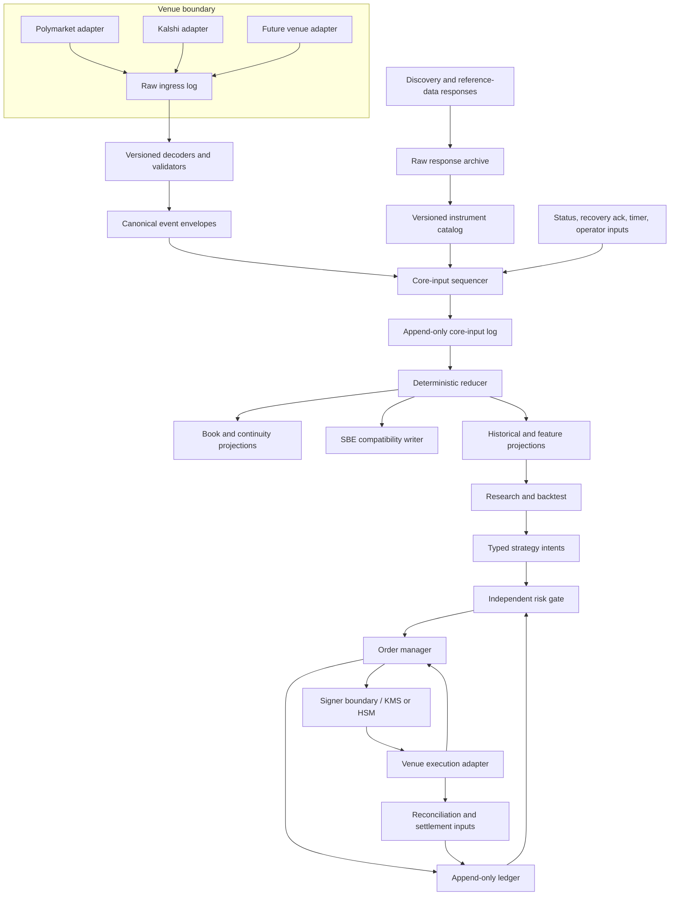

# Event-market platform — architecture and engineering charter

**Version:** 1.0-draft  
**Date:** 2026-11-02  
**Repository:** `kj111422/engineering-challenge-template`  
**Reviewed integration commit:** `e19a85c204d0eaf54d862502035947d21d12f149` (`polymarket-continuity-failure`)  
**Baseline `main`:** `9ab6cd5a584fea58c0086efa50d55c796e9aac4e`

This design targets three uses without creating three systems:

1. **Own-account research and trading** — a private research and execution stack.
2. **Market making** — inventory, queue uncertainty, latency, fee and capital controls.
3. **A platform for other users** — tenant isolation, data contracts, completeness evidence, access controls and service-level measurement.

The common core is a venue-neutral event log and deterministic state-transition engine. Strategy, account, tenant and venue policy are configuration and boundary concerns; they must not fork the book or order state machines.

This document is an engineering proposal. ADRs are proposed, not accepted. No live order management, risk service, ledger or signer is claimed to exist.

### Assurance baseline

The engineering baseline in [`docs/assurance/`](../../assurance/README.md) extends this charter with a controlled software lifecycle, Rust correctness rules, financial-market controls, canonical terminology, audit tooling and verification records. It covers software assurance, requirements traceability, electronic trading, financial risk, market integrity, custody, settlement and multi-tenant operation.

The baseline uses NASA, NIST, CPMI-IOSCO, SEC, SEBI, CFTC and FIX publications as references with different scopes. It does not claim NASA certification, regulatory compliance, exchange membership or production readiness. Applicability to a venue, product, customer class or jurisdiction requires legal and compliance review.

---

## 1. Current repository state: code, not aspiration

### 1.1 Branch truth

At the time of review:

| Ref | Commit | State |
|---|---|---|
| `main` | `9ab6cd5` | Collector baseline |
| `polymarket-continuity-failure` | `e19a85c` | 16 commits ahead of `main`, 0 behind |
| PR #2 | merged into `polymarket-continuity-failure` | Merge commit `e19a85c` |

> **Status update (2026-11-05):** Phase 0 is complete. `main` fast-forwarded from `9ab6cd5` to `275f78f`, then accepted the assurance baseline and the first JH-4 storage-correctness group. `polymarket-continuity-failure` and `journal-failure-hardening` were retired after ancestry and open-PR checks. Only `main` remains as a permanent branch; topic branches are short-lived. History is linear from `275f78f`, while merge commits `20b4a01` and `e19a85c` are retained as historical evidence. The table above records the review-time state, not the current ref set.

The journal hardening source head `5924eb6` had passing Rust CI and architecture Actions. The merge commit and source head have the same Git tree. The reported run covered 221 library tests, 12 mock E2E tests, and 2 replay tests: 235 passed, 3 ignored; the architecture gate reported 238 attributed tests. This is CI evidence for that tree, not a fresh local build performed for this design. At review time, the integration branch had **not** reached `main`; the status update above records its later promotion.

Relevant branch work separates into three areas:

- Polymarket feed-contract fixtures and decoder tests (`0235b103`).
- Continuity/failover and clockless recovery fencing (`ce61a34e`, `36a0cfff`, `74140c48`, `ce6f2433`, `13bc7e0d`).
- Raw-frame journal and hardening (`4362283d` through `e19a85c`).

The integration range served as the review baseline. The Phase 0 promotion record documents the commit-group review and the fast-forward from `9ab6cd5` to `275f78f`; later changes use short-lived topic branches and squash merges.

### 1.2 What the code already does

The promoted baseline contains:

- Polymarket public Gamma discovery and CLOB market-data WebSocket adapters, plus Kalshi adapters.
- A synchronous `CollectorCore` used by live collection and normalized JSONL replay.
- Per-symbol continuity state and per-source shadow books, with active-source selection and recovery controls.
- A raw application-payload journal. `journal_ingress` records text/binary payloads before decode decisions, including rejected payloads. Records carry source shard/replica, connection epoch, receive sequence, receive wall time, frame kind and decode outcome.
- Queue-failure latching, producer admission guards, bounded shutdown/abort, segment checksums and a verifier.
- A normalized JSONL replay path for discovery, snapshot, delta, lifecycle, reset, source status and timer tick inputs.
- SBE output, metadata/catalog persistence, capacity preflight, metrics and mock exchange tests.

**Correction to the supplied initial critique:** the raw journal already preserves source/replica identity and records frames before the core selects an active source. Redundant-source arrival information is not simply collapsed at raw write time. The canonical SBE output is an active-source projection; the raw tier retains per-source observations. The next task is to exploit that retained information, not build a second raw tier.

### 1.3 Verified gaps in the current source

The following are source-level findings at `e19a85c`, not guesses from README prose.

| Area | What exists | Gap to close |
|---|---|---|
| Raw journal | Append-only `.pmj` segments, raw WebSocket text/binary payloads, source/epoch/receive sequence, wall timestamp, decode outcome, manifest, checksums, verifier | No reader replays raw bytes through the venue decoder and `CollectorCore`. Header has no monotonic receive timestamp, explicit connection UUID, negotiated protocol-version tuple or clock-sync uncertainty. SHA-256 checksums detect corruption, not a malicious rewrite. |
| Core replay | `src/replay.rs` consumes normalized JSONL for discovery, snapshot, delta, lifecycle, reset, status and tick | It is not a raw-frame replay. It does not model every live coordinator input: `RecoveryReady` acknowledgements are handled live through `core.handle_recovery_ready` but are not a `ReplayRecord`. Replay-created `EventMeta` sets `connection_epoch` and `receive_seq` to zero. Controls drained by replay are discarded because replay has no workers. |
| Live orchestration | `src/coordinator.rs` applies initial and periodic discovery, source events/status, one-second ticks, recovery acknowledgements, shutdown/final snapshots | These core inputs are not all appended to the raw journal. Raw frames alone cannot regenerate every core transition. |
| Instrument identity | `MarketInfo` has string identifiers, outcome/title, close time, tick and Kalshi price-range data. Polymarket discovery parses market version to choose CTF token IDs versus position IDs | It does not retain a typed economic claim/listing split or all listing metadata: minimum size, fee schedule, explicit neg-risk relation, collateral asset, protocol-version tuple, lifecycle evidence and resolution policy. Parsing a Polymarket `version` to choose an ID format does not make that field a complete exchange protocol version. |
| Price model | Fixed-point values and a normalized binary book; Kalshi price ranges are represented | Native venue quote representation and canonical economic representation are not modelled side by side. Fee and collateral semantics are not part of the price model. |
| Continuity | `ContinuityState` exists and the core has extensive transition logic and tests | `MarketState::set_continuity` directly assigns a state. The transition policy is not an exhaustive pure transition function/table. `collector/state.rs` is a large responsibility cluster. |
| Trading | None in this milestone | No strategy-independent position ledger, independent pre-trade risk gate, OMS, signer, account reconciliation or settlement state machine. |
| Operations | Journal write/sync fault tests and bounded shutdown/abort | No documented 24-hour fault-injection soak, live Kalshi validation, isolated physical disk-exhaustion drill or full-universe live evidence. |

### 1.4 Design rule

Do not delete or replace the existing collector. Turn it into the first projection of a larger event-market platform. Keep SBE as a compatibility output; make the event log and typed domain model authoritative for new capabilities.

---

## 2. Product and engineering thesis

Build a venue-agnostic truth, research and execution platform for contingent-claim markets. The system must be able to answer, for every derived state:

- Which raw observations and non-market inputs produced it?
- Which venue protocol, decoder, core revision, configuration and instrument version were used?
- Which observations are known to be missing, rejected, late or unquantifiable?
- Which state transition occurred, and which side effects followed?
- Which account, tenant, policy and risk decision authorized an action?
- Can an independent process replay the same ordered inputs and reproduce the same outputs?

The lifecycle is:

**Observe → Normalize → Remember → Decide → Act → Reconcile.**

A single deterministic reducer is the common engine for live, raw replay, core replay, backtest and paper execution. Simulation is allowed to produce synthetic venue events; it is not allowed to implement a second order or portfolio state machine.

### Non-negotiable invariants

1. **Log is truth.** Every input to a persistent state machine is recorded before or atomically with state application.
2. **One reducer.** Live, replay, backtest and paper use the same deterministic transition code.
3. **No timestamp sorting.** Processing order is the recorded input sequence. Event time and receive time are separate dimensions.
4. **Unknown blocks risk.** Unknown eligibility, fee, instrument version, book continuity, order status, account balance or settlement status cannot silently become a safe default.
5. **Raw preservation.** Decoding and normalization never destroy the original venue payload or native quote representation.
6. **Effects at the edge.** Network, disk, clocks, signing, user policy and external API calls do not occur inside the deterministic reducer.
7. **Provenance is queryable.** Derived data points and trading decisions resolve to log offsets and immutable version identifiers.
8. **No live route by default.** No live signer key, venue order route or capital permission is enabled until all independent gates pass.
9. **Eligibility is a hard deny.** The system must not route around venue access rules, jurisdiction or account eligibility.
10. **No unsupported claims.** A capability is not “production ready” because a mock test passes.

---

## 3. Target architecture



### 3.1 Layers and ownership

| Layer | Owns | Must not own |
|---|---|---|
| Venue adapters | Protocol parsing, transport, venue-native identity, authentication at approved boundary, capability declarations | Economic truth, cross-venue matching, strategy decisions |
| Raw ingress | Verbatim application payloads and REST response bodies, receive provenance, durable append | Decoded market state |
| Canonicalization | Typed venue-neutral events plus native values and raw references | Order routing or account secrets |
| Instrument catalog | Economic claims, venue listings, versioned metadata, resolution rules, relations | Mutable book state |
| Deterministic core | Books, source continuity, instrument lifecycle and later portfolio/order/risk reducers | I/O, wall clock, random numbers, network calls |
| Projections | SBE, current book views, analytics, metrics, search indexes | Authoritative state mutation |
| Research | Feature generation, event-time analysis, simulation assumptions, reports | Live signing keys or live order endpoints |
| Risk | Account/event/market limits, eligibility and data quality gates, reservations, kill state | Strategy optimization or signing |
| OMS | Intent/order lifecycle, idempotency, query-before-retry and order reconciliation | Private signing keys |
| Signer | Policy-checked signature for a validated request | Strategy state or market data |
| Ledger | Immutable postings and reconciled account/position projections | Strategy estimates or unverified order assumptions |
| Platform control plane | Tenants, access policy, quotas, evidence manifests, audit | Cross-tenant data visibility |

### 3.2 Deployment sequencing

Start with a modular monolith and strict module/port boundaries. Do not introduce Kafka, Kubernetes, ten microservices or a distributed transaction system merely to look like a large firm. The first boundary extraction should be process-level only where it materially improves custody, failure isolation or independent risk control.

Required process boundary before any live order:

- The strategy process cannot sign or change risk limits.
- The OMS cannot access private keys.
- The signer cannot evaluate or alter strategy intent; it signs only a validated, scoped order digest.
- The kill switch and risk deny path remain available if the strategy process stops or misbehaves.

A platform deployment later adds tenant isolation, per-tenant keys, quotas, audit, API contracts and service-level telemetry. Those are not reasons to distribute the deterministic core prematurely.

---

## 4. Data tiers and authoritative streams

The platform has three logical data tiers and three kinds of append-only stream.

### Tier 1 — Raw

Verbatim venue payloads and raw reference-data responses. Keep all application data payloads before decode, including malformed, unknown and rejected payloads. Preserve one record per source/replica, not one record per canonical book.

For forensic completeness, optionally write WebSocket control observations (ping, pong, close) to a transport-observation stream with a separate transport sequence. They must not consume the application receive sequence used by book fences.

### Tier 2 — Canonical

Typed events that preserve both venue-native values and normalized economic values. Every event has a reference to one or more raw records, decoder version, schema version and normalization result. Unknown additive events remain representable as `Unknown { raw_type, raw_ref }`; they are not discarded.

### Tier 3 — Derived

Book snapshots, best bid/ask, features, strategy signals, exposure, completeness certificates, historical partitions and customer-facing views. These are rebuildable projections, not the source of truth.

### Authoritative stream model

1. **Raw ingress stream:** per `(tenant, venue, capture, source, connection)` order. It carries raw bytes and provenance.
2. **Core-input stream:** one total order per deterministic core run. It carries exactly the inputs consumed by the reducer: canonical venue events, discovery snapshots, source status, recovery acknowledgements, logical timer ticks, operator actions and lifecycle boundaries.
3. **Effect/result stream:** records the reducer's requested effects, their dispatch and the external acknowledgement/result that re-enters the reducer. A replay can then reproduce the same causal path without contacting a venue.

The raw and core-input streams are linked, not conflated. A `CoreInput::VenueEvent` references the originating `RawFrameId` and event ordinal within the decoded frame. An API discovery snapshot references raw response objects and the canonical catalog revision.

---

## 5. Core contracts

### 5.1 Deterministic reducer

The reducer is synchronous, deterministic and side-effect free:

```rust
fn step(
    state: &CoreState,
    input: &CoreInput,
    config: &CoreConfig,
) -> Result<Transition, CoreError>;

struct Transition {
    next_state: CoreState,
    outputs: Vec<CoreOutput>,
    effects: Vec<CoreEffect>,
}
```

`step` must not:

- Read system time, sleep, generate randomness or query an API.
- Write files, metrics, logs that affect the result, or network messages.
- Depend on hash-map iteration order or process scheduling.
- Infer an unrecorded input.

Timers enter as `CoreInput::TimerFired { logical_time, timer_kind }`. A wall-clock observation is recorded before it becomes a core input. `CoreEffect` IDs are deterministic from `(run_id, input_offset, effect_ordinal)`.

### 5.2 Live path

1. Transport reads a frame and captures timing/connection metadata.
2. Raw ingress appends the frame and returns a `RawFrameId`.
3. The pinned adapter decoder parses the bytes into typed canonical events or a rejection/ignore outcome.
4. The core-input sequencer assigns the next total-order offset and appends the exact input.
5. The reducer applies that input and returns outputs/effects.
6. Outputs are committed to projections; effects are dispatched by edge workers and their results are appended as later core inputs.

If the raw append fails, do not pass the frame into the core while reporting the capture as complete. If the core-input append fails, do not apply the input and pretend the run is replayable. Fail closed and expose the exact failed stage.

### 5.3 Replay modes

- **Core replay:** read the core-input stream and run the same reducer. This is the primary determinism gate.
- **Raw re-decode replay:** read raw frames, use a selected adapter/decoder version, regenerate canonical events and then run the reducer with the corresponding recorded non-frame inputs. This is the forensic and decoder-upgrade path.
- **Backtest replay:** run the same reducer and strategy interface against historical inputs; simulated fills are generated by a separate deterministic execution simulator and then enter the same OMS/portfolio reducers as execution events.
- **Paper replay:** live market feed plus simulated execution adapter; the live order route is absent by construction.

A byte-for-byte output claim requires identical core inputs, core revision, config, schemas, clock inputs and writer version. Re-decoding with a newer decoder is expected to be allowed to change outputs; compare old/new canonical events and explain the delta rather than demanding equality with the previous decoder.

---

## 6. Current Polymarket/Kalshi protocol implication

Protocol versioning must be multidimensional. Do not overload one field called `version`.

For Polymarket keep separate fields for:

- Market identifier scheme: CTF token ID versus Protocol V2 position ID.
- Public market-data API contract/version.
- CLOB API version.
- Exchange contract generation and EIP-712 domain version.
- Collateral asset and chain/contract identity.
- Fee model revision and source.

Polymarket's April 28, 2026 exchange upgrade introduced new exchange contracts, a rewritten order book and pUSD collateral; the help center states fees are calculated at match time. Its Rust client project documents distinct token-backed V1/V2 and position-backed V3 protocol paths. Treat these as independent versioned facts, not one universal `market_version`. [Polymarket upgrade notice](https://help.polymarket.com/en/articles/14762452-polymarket-exchange-upgrade-april-28-2026) · [Polymarket Rust CLOB client](https://github.com/Polymarket/rs-clob-client-v2).

For Kalshi retain full native fields. Its current multivariate event API schema exposes mutually-exclusive metadata, settlement-source references, full price ranges and fee override fields; a single `tick_size` or normalized YES book is not the full venue contract. [Kalshi multivariate events API](https://docs.kalshi.com/api-reference/events/get-multivariate-events).

Do not hard-code current endpoints or fee formulas into the economic domain model. Each adapter pins a protocol contract, has golden fixtures and supplies a versioned fee/capability snapshot.

---

## 7. Roadmap and decision gates

The full implementation plan is in [`roadmap.md`](roadmap.md). The order is deliberate:

1. Land and freeze the existing collector, continuity and journal work on `main` with evidence.
2. Specify the unified input log and deterministic core-input contract.
3. Add typed instrument/listing metadata and native/canonical quote representation.
4. Add raw-decode-core replay equality in CI.
5. Convert continuity to a pure exhaustive transition function.
6. Run operational evidence: live validation where legally and account-authorized, fault-injection soak, physical disk exhaustion, retention/restart and drift alarms.
7. Build historical research and conservative fill simulation.
8. Build paper OMS, risk reservations, double-entry ledger and reconciliation.
9. Only after legal, jurisdictional, security and technical approvals: consider a restricted canary.
10. Add venue three only when it changes zero shared core files.

### Stop conditions

- Missing or stale listing metadata blocks order intents.
- Missing fee formula blocks fee-aware backtest claims and live risk approval.
- Unknown continuity blocks quotes and orders for the affected instrument.
- Raw/core log failure blocks a completeness claim.
- Unknown order submission blocks resubmission until queried/reconciled.
- Ledger mismatch blocks new risk for the affected account.
- Unknown eligibility denies order routing.
- Kill switch must stop new intents and cancel/disable outstanding routes according to a tested venue-specific policy.

---

## 8. Artifact map

- [`repo-audit.md`](repo-audit.md) — source links, code-level corrections and pinned evidence.
- [`data-model.md`](data-model.md) — canonical economic and venue models, quotes, order, risk, ledger and completeness types.
- [`input-log-and-replay.md`](input-log-and-replay.md) — record schema, ordering, replay and migration rules.
- [`state-machines.md`](state-machines.md) — pure reducer contract and transition tables.
- [`security-and-operations.md`](security-and-operations.md) — trust boundaries, eligibility, custody, monitoring and evidence gates.
- [`roadmap.md`](roadmap.md) — PR stack, phase gates, tests and acceptance evidence.
- [`adrs/`](adrs/) — ten proposed architecture decision records.
- [`docs/assurance/`](../../assurance/README.md) — software-assurance baseline, Rust standard, financial-market controls, terminology and verification records.

## 9. Evidence and scope discipline

At the reviewed integration head, the repository has source and test evidence for a collector, continuity controls and a raw-frame journal. It does not have evidence for raw replay equality, live Kalshi operation, a 24-hour fault-injection soak, physical storage exhaustion, a fee-aware strategy, a ledger, OMS or live trading.

No trading system, signing key or capital route is authorized by this design. This is not legal advice. Venue and jurisdiction access must be validated by the responsible operator and qualified counsel before any account or order integration.
